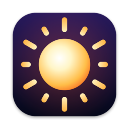

<p align="center"></p>

# XDR Brightness

A small macOS menu bar app for the **built-in Liquid Retina XDR display** on a MacBook Pro. Continue increasing brightness with **F2 after reaching the SDR limit**, adjust XDR boost by scrolling inside the popup, and see estimated brightness in nits.

[Download the latest DMG](https://github.com/adanramzan/XDR-brightness-control-macbook/releases/latest) · [Report a bug](https://github.com/adanramzan/XDR-brightness-control-macbook/issues/new/choose)

## Install

1. Download `XDR-Brightness-<version>-universal.dmg` from [Releases](https://github.com/adanramzan/XDR-brightness-control-macbook/releases).
2. Open the DMG and drag **XDR Brightness** to **Applications**.
3. Open the app, then click its sun icon in the menu bar.
4. Choose **Enable F1/F2 control…** and enable **XDR Brightness** in **System Settings → Privacy & Security → Accessibility**. The app checks for permission automatically; quit and reopen it if the keys remain unavailable.

The release is **ad-hoc signed and not Apple-notarized**. macOS may require approval under **System Settings → Privacy & Security → Open Anyway** after you first try to launch it. Do not disable Gatekeeper. Source is included with each release if you prefer to build it yourself.

## Controls

| Control | Behavior |
| --- | --- |
| F2 / brightness-up key | Uses normal macOS brightness below the SDR maximum, then raises XDR boost in 16 steps. |
| F1 / brightness-down key | Lowers XDR boost first, then returns to normal macOS dimming. |
| Hold a brightness key | Repeats brightness changes. In the XDR range a brightness HUD shows the boost level and estimated nits. |
| Option–Shift + brightness key | Uses finer XDR steps. |
| Scroll inside the open popup | Adjusts XDR boost; the nits readout updates immediately. |
| XDR slider | Adjusts boost from neutral to the peak target. |
| Native brightness slider | Adjusts the display's standard hardware brightness. |
| Quit | Restores the normal gamma table and removes the EDR trigger. |

Boost starts at neutral. Without Accessibility permission, the sliders and scrolling work, but the brightness keys stay within macOS's normal SDR range. The top bar stays icon-only; the **≈… nits** readout is inside the popup.

If your keyboard uses standard F1/F2 function keys, use its brightness-key combination (usually Fn/Globe + F1/F2). Plain F1/F2 function events are intentionally left available to other apps. Option–brightness shortcuts such as opening Display Settings are preserved.

## What “1600 nits” means

This app targets the display's **1600-nit peak range** by keeping the display in EDR mode with a 1×1-pixel Metal trigger in the top-left corner and scaling the display gamma table by up to 3.2× linear gain (capped at the headroom macOS currently grants). It does **not** measure the panel, unlock Lunar's private native full-range implementation, or guarantee sustained 1600-nit output.

The **≈** readout is an estimate from the normal brightness setting and boost gain, using an approximate M1 XDR SDR curve (140 nits at native 50%, 500 nits at native 100%). At hardware 100% and maximum software gain, it displays **≈1600 nits**. Actual luminance depends on content, display headroom, automatic brightness, macOS, power and temperature. The estimate is calibrated around the M1 Pro/Max generation and can be inaccurate on newer models.

Software upscaling may affect HDR colors and highlights, uses some GPU power, and can interact with Night Shift, True Tone or other display-adjustment apps. Do not run another XDR booster at the same time. Disable boost for color-critical HDR work.

## Compatibility

- macOS 12 or newer; universal `arm64` and `x86_64` executable.
- The feature requires a **built-in XDR-capable MacBook Pro display**. External displays and SDR-only screens are not supported.
- Development hardware: M1 Max MacBook Pro (`MacBookPro18,2`) on macOS 27.0.1.
- Other hardware/macOS combinations are not yet hardware-tested. A universal binary does not make non-XDR Intel displays compatible.

## Build and test

Install full Xcode and select its developer directory, then:

```sh
git clone https://github.com/adanramzan/XDR-brightness-control-macbook.git
cd XDR-brightness-control-macbook
bash scripts/test.sh
bash XDRBrightness/build.sh
open "dist/XDR Brightness.app"
```

No package manager or third-party package download is required. `VERSION` controls the app and release version. To create the DMG and source archive from the current committed revision:

```sh
bash scripts/package.sh
```

An optional hardware smoke test temporarily boosts the built-in display, checks rendering, native brightness read/write, the popup readout, and cleanup, then exits:

```sh
"dist/XDR Brightness.app/Contents/MacOS/XDRBrightness" --self-test
```

The smoke test reports Accessibility trust and event-tap status separately; a passing rendering test does **not** prove physical F1/F2 interception works. Test holding both brightness keys across the SDR/XDR boundary after granting permission. CI runs policy tests and universal builds; it cannot measure physical nits or test a built-in XDR panel on hosted runners.

## Troubleshooting

**F2 still stops at SDR:** check Accessibility permission for this exact installed app. Quit other brightness-key managers while checking. The popup's permission item disappears when its event tap is running. Native system brightness feedback may remain at 100% while XDR gain increases; use the popup's estimated-nits readout.

**Boost unavailable:** use the built-in XDR display with the lid open. The app disables the feature when that screen is unavailable and suspends boost while the display sleeps or the session is inactive.

**Display looks wrong:** move the XDR slider fully left or quit the app; this restores the system gamma table (macOS also restores it if the app exits unexpectedly). Software boost does not change your display preset.

## License and credits

GNU GPL v3; see [LICENSE](LICENSE) and [NOTICE](NOTICE). The Metal EDR approach is adapted from [BrightXDR](https://github.com/starkdmi/BrightXDR) by Dmitry Starkov (GPL-3.0); the 1-pixel trigger plus gamma-table technique follows [BrightIntosh](https://github.com/niklasr22/BrightIntosh) (GPL-3.0). Media-key event format references come from [MediaKeyTap](https://github.com/MonitorControl/MediaKeyTap) by Nicholas Hurden; its MIT notice is included. This project is independent of Lunar, BetterDisplay and MonitorControl.

See [CONTRIBUTING.md](CONTRIBUTING.md) for development and [SECURITY.md](SECURITY.md) for reporting security issues.
